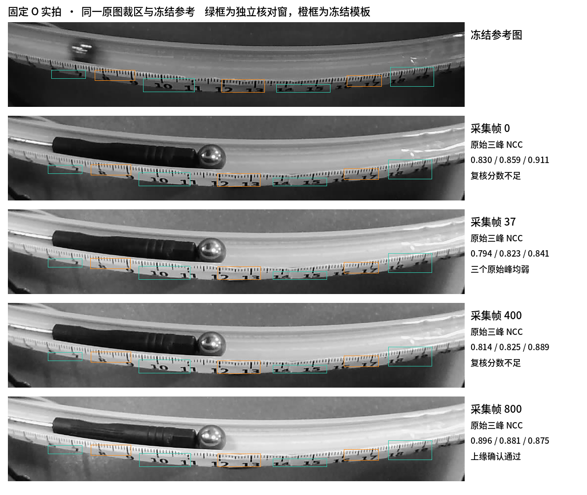
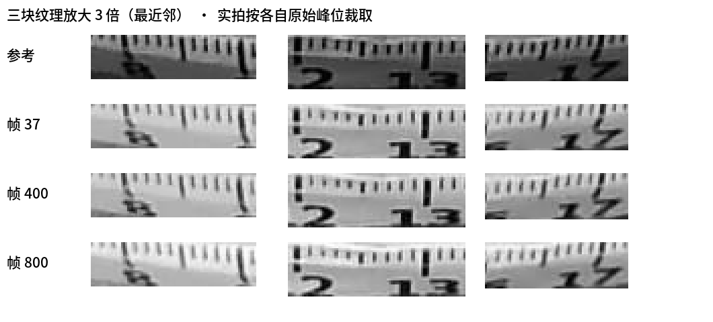

# 固定 O、手动倾斜片段的纸尺失效诊断

**现场 614 个无效参考帧中，611 帧的直接原因相同：第一个尺面模板的旋转复核分数低于 0.85。第 37、38、450 帧的三个原始峰都低于 0.85，因而没有进入旋转复核。** 帧号从 0 开始。全片没有上缘确认或相似变换超限造成的板端拒绝。

## 数据和同帧复现

| 输入 | SHA-256 |
|---|---|
| fixed_O_tilt/raw.mjpg | 98f1a56007f9a966939aca87a0dffb3f63695365c557c3cfe59ef989d730a2e7 |
| frames.csv | 3f57faa47e612eab552b53214c1e699aeb61f29de90d9c333dfd9461a3ba2beb |
| measurements.csv | b0f3a4d26140115604017d7e1ce5ddf33e12eed12528b9907125adf41b75f103 |
| config_motion_topview_20261121.json | bdd42b08fa7676e909b7d0861c068c5131945a150163c1a6e7c9dc998575287e |
| ruler_reference.py | 25f7901f3b7410a300d02d27439526e20813eb48d71ae9220b3eba2563cb5f06 |
| moving_reference.png | 3c6da668646e530e87fc80368bd68fdef1be0c5f59344afd466ba7cc1505eff3 |

直接读取仓库 Jetson 下与冻结摘要相符的入口、配置、图像和匹配器。以 FFmpeg 直拷原 JPEG 负载，按原入口解码 BGR 后转灰度。按现场帧号与读帧时间戳对齐，仅向第一个跟踪器送入进入现场测量的帧，另一个跟踪器独立接收所有帧。

| 序列 | 上缘确认 | 旋转复核纹理弱 | 原始提议不可信 | 对照日志的原因差异 |
|---|---:|---:|---:|---:|
| 现场实际处理的 725 帧 | 111 | 611 | 3 | 0/725 |
| 全片连续处理的 895 帧 | 134 | 756 | 5 | 0/895 |

两组数据跨度均为约 30.0 s。170 个跳帧只计入全片序列。现场第 774 到 894 帧之间实际处理的 101 帧全部有效。

## 模板、亮度和空间采样

橙框为三个冻结模板，绿框为独立核对的尺面数字。绿框匹配位置仅用于审计。放大图按各自原始最佳峰对齐，未对局部亮度做拉伸。

| 帧 | 左 / 中 / 右原始 NCC | 左 / 中 / 右旋转复核 NCC | 现场结果 |
|---:|---|---|---|
| 0 | 0.830 / 0.859 / 0.911 | 0.837 / 0.908 / 0.906 | 左块拒绝 |
| 37 | 0.794 / 0.823 / 0.841 | 未进入 | 提议拒绝 |
| 400 | 0.814 / 0.825 / 0.889 | 0.814 / 0.884 / 0.897 | 左块拒绝 |
| 800 | 0.896 / 0.881 / 0.875 | 未触发，原始匹配已通过 | 上缘有效 |

- 左块为参考图 `[390,632,82,22]`，主体是数字 8 上部及相邻长短刻度。611 帧复核分数范围 0.776–0.849，中位数 0.830。排除峰值附近 2 px 后，左块主峰与次峰之差最小 0.127，高于 0.05 门限。没有一帧因竞争峰间隔不足而拒绝。
- 为区分首个失败和全部失败，对算法本来会提前返回的后两块也在同一姿态下补算。611 帧中，中块有 4 帧同时低于 0.85，右块 0 帧；三块的复核峰间隔全部通过。补算值没有进入正式判定。
- 614 个无效帧中，左块相对参考的平均灰度增量中位数为 **+81.4**（8 位灰度），上、下各三分之一分别为 **+64.3、+95.8**；块内灰度标准差变为参考的 **0.835 倍**。中、右块的标准差却分别变为 **1.314、1.204 倍**。左块像素达到 250 的比例中位数为 0，最大仅 0.055%。相邻区域的相对明暗和笔画对比变化可在放大图中看到。
- NCC 会抵消统一的加性亮度和平移后的正线性增益。有效帧左块反而平均更亮（灰度增量中位数 +92.3），其上下分区增量更接近（+87.3、+93.5）。用交错 8×8 像素块两折验证，在全块增益和偏置之外加入垂直亮度渐变，左块误差平方和在无效帧上中位再降 7.0%，有效帧仅降 0.3%。这说明空间亮度分布解释了部分失配。录像缺少曝光、光源和遮挡的独立记录，无法把剩余变化唯一归到某个物理原因。
- 在原始整数峰附近仅试九个半像素相位，614 个无效帧中有 305 个左块原始 NCC 可以达到 0.85。这个实验只衡量局部空间采样敏感性，只试主峰，不能用来宣告这些帧身份有效。光照分布和采样相位均对这块较矮的模板有影响。

## 误配、球挡和物理转角

冻结的 3 点原始峰在 **725/725** 个现场帧均满足几何门限。左块在无效帧中横移 −9 至 −8 px，纵移 +1 至 +3 px，明显处在 ±96 px 搜索域内。725 帧相似拟合的图像旋转为 **−0.451° 至 −0.221°**，尺度为 1.002–1.008，最大点残差 **1.454 px**；门限分别为 ±5°、0.9–1.1、2.5 px。失效帧中的姿态均为诊断提议。

另用 4 块完全不重叠的印刷数字独立做全窗搜索，要求 NCC ≥0.85、峰间隔 ≥0.05。725 帧每帧至少有 3 个独立窗通过，710 帧四窗全过。最外侧合格数字连线给出的图像角变化为 **−0.411° 至 −0.247°**。冻结正式接受的 111 帧，对这些数字的逐帧最大位置差 P95 为 3.12 px，全段最大 3.17 px；614 个拒绝帧的原始提议对应数值为 3.16、3.39 px。数字顺序、连续位移和角度都支持匹配落在同一段纸尺，未见锁到另一组数字的证据。几像素的独立位置差仍存在，不能据此认定亚像素精度。

现场操作员确认球挡未动。以实拍第 0 帧的球面小窗独立配准，614 个无效帧中 607 个与首帧的整数峰重合，其余 7 个仅差 1 px；这 614 帧的最低球面 NCC 为 0.966，最低峰间隔 0.122。单独选取的黑挡左端窗身份区分度不足，不能据此精确测量挡块位移。现场信息和画面证据均不要求用球挡移动来解释本次失败。

**可以排除冻结软件的图像转角门限触发。** 照片中的角度是纸尺投影在成像平面的变化；手动 ±0.5° 是操作条件。缺少同步角度传感器或该转轴的相机几何标定，无法反推出机械转角或判定其真实极值。

## 复算

在本目录依次运行 `OPENBLAS_NUM_THREADS=1 python3 -B diagnose.py`、`OPENBLAS_NUM_THREADS=1 python3 -B controls.py` 和 `OPENBLAS_NUM_THREADS=1 python3 -B guarded.py`。脚本在本目录写结果，使用冻结配置前核对摘要。OpenCV 版本 4.8.1。

[逐帧冻结证据](frames_evidence.csv) 含原始主次峰、各框亮度、旋转复核强度、三点几何、独立窗匹配位置和两种回放结果。[对照试验](controls.csv) 含半像素试验、垂直光照项、球面及黑挡局部匹配、独立图像角。[可选离板修复报告](optional_fix.md) 单独列出候选和负例结果。
