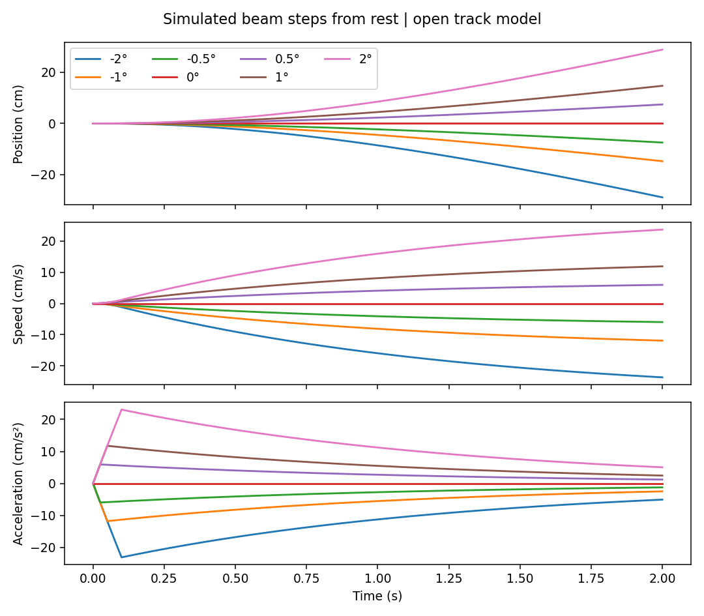
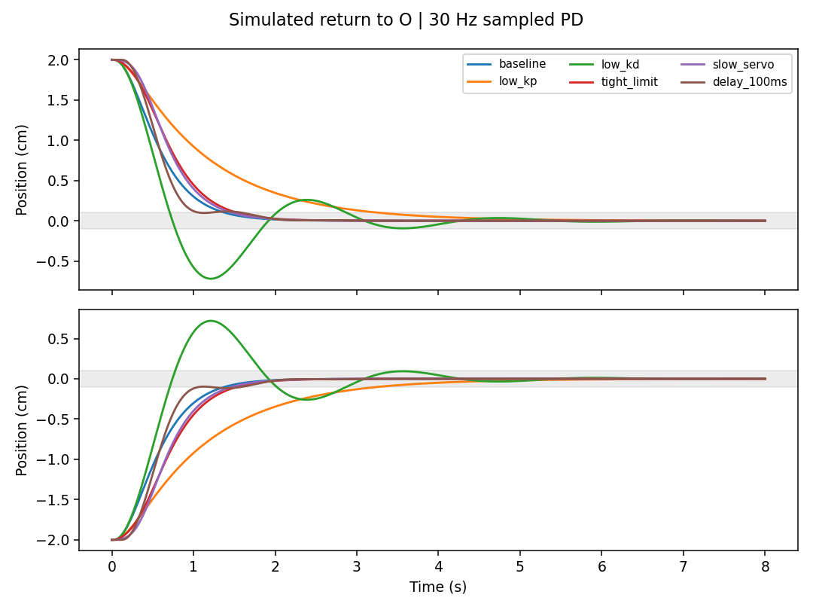

# 第一阶段离板验证 · 2026-11-21

点坐标去畸变值得在下次实机对照中保留。两段独立摆放的静态留出录像共 300 帧，A、B 在相同的 291 帧有厘米输出，平均绝对误差从 0.125 降至 0.028 cm。±5 cm 处的主要损失来自标定域端点的定义，点矫正后依然存在。所有运行都在电脑完成。控制及 IMU 曲线来自确定性仿真，现有部署配置和固件保持原状。

## 视觉几何

输入是 11 月 20 日固定球心录制的五个位置，每段 150 帧；逐段比对正式模型保存的视频 SHA-256 和完整标注区间。每帧只运行一次 topview-circle-v1、纸尺匹配和跟踪。A 走原图 RailCoordinates 并加载原有厘米模型；B 复用同一候选与纸尺匹配，在 CameraGeometry 的 points 模式下对球心及纸尺对应点去畸变，重新估计变换，在矫正后的轨道轴上投影。两条路径都没有对图像重采样。B 模型只绑定 points 模式，使用 −5、0、+5 cm 三段的中位数拟合，±3 cm 保留验证。两段留出录像已用于以往静态验收，同一位置的连续帧共享一次摆放误差。

表中误差只统计该路径实际输出的厘米值，覆盖率分母为每段完整的 150 帧。像素变化是有对应点的帧上 B 减 A，球心和参考图球心列为二维距离中位数，轴向变化保留符号。

|已知位置 cm|用途|轨道坐标帧|厘米输出帧 A / B|平均有符号误差 A / B cm|最大绝对误差 A / B cm|球心 / 参考图球心变化 px|轴向变化 px|
|---:|---|---:|---:|---:|---:|---:|---:|
|−5|拟合|142|71 / 71|+0.083 / +0.093|0.163 / 0.178|19.98 / 23.18|−20.23|
|0|拟合|146|146 / 146|−0.080 / −0.091|0.103 / 0.113|2.16 / 5.34|+0.34|
|+5|拟合|144|83 / 72|+0.016 / +0.017|0.071 / 0.073|23.33 / 27.88|+24.22|
|−3|验证|146|146 / 146|−0.137 / −0.049|0.171 / 0.084|7.60 / 10.43|−7.10|
|+3|验证|145|145 / 145|+0.112 / +0.005|0.147 / 0.039|8.36 / 12.24|+8.51|

A 的公式为 x = 0.01722038 s − 0.12882347，B 为 x = 0.01599671 s − 0.14213634（s 单位 px）。参考轴的左、零、右三个锚点分别移动 (−26.76,+16.34)、(−0.16,+5.54)、(+28.07,+18.89) px。B 通过原有程序对两个留出位置的验证。另以本机相同三段重拟合 raw 模型，其留出 MAE 为 0.1251 cm，接近 A 的 0.1246 cm。B 的对应值是 0.0277 cm。这一改善局限于该机位与本批录像。

**端点越界。** 软件以最外两组轨道坐标的中位数定义线性模型的可用域。A 域为 [−280.55, 300.05] px；本机 −5 cm 坐标实际跨 [−284.18, −273.39]，+5 cm 跨 [293.73, 300.96]。A 在两端分别有 71、61 个已识别的帧越域，另有 8、6 帧连轨道坐标都未得到。B 域为 [−300.79, 324.19]，两端分别有 71、72 帧越域。因为端点样本会在中位数两侧分布，检测 ROI 即使覆盖至 ±7 cm 也无法解决此问题。端点的厘米误差统计只覆盖进入模型域的那部分样本。旧 Nano 报告 +5 cm 为 138 个轴坐标、71 帧厘米值；本机同片回放为 144 和 83。跨平台差异的具体来源尚未定位，A/B 已使用同一电脑和同一份检测结果。

**残差。** A 两个独立位置的偏差都向远离 O 的方向，超过各处约 0.008～0.021 cm 的帧间标准差。B 明显减小了两处偏差；−3 cm 仍有 −0.049 cm 的均值偏差。每个位置只有一次物理摆放，现有证据不足以判定还需分段拟合，或量化真实摆杆俯仰造成的透视误差。

[逐帧 A/B](vision/same_frames.csv) · [五点统计](vision/vision_summary.csv) · [同帧留出统计](vision/holdout.csv) · [B 的绑定与标定证据](vision/points_model.json)

## 滚球与 PD 数值实验

模型取 x″ = 12 θ − 0.8 x′，x 单位 cm，θ 单位度。两个系数均为模拟假设。正 θ 定义为使钢珠向 +x 加速的摆杆倾角。七个恒指令从静止开始，经 20°/s 斜率限制；以 300 Hz 积分，导出 100 Hz 时序。2 s 时，0° 保持静止；+0.5°、+1°、+2° 的模拟位移分别为 7.44、14.74、28.88 cm，负角对称。模型采用无限长轨道，超出实物范围的数值仅供核对模型趋势。未建模轨端碰撞、静摩擦、死区、连杆间隙或 PWM 到实际角度的误差。

PD 参考 Car2 提交 b81519b 的 ball_control.c 和 servo.c。仿真以 30 Hz 取位置、帧间差分估速、0.60 旧速度加 0.40 新速度低通，按 Kp(0−x)−Kd·v 输出，基线限幅 ±2°、限速 20°/s。默认增益单位为 °/cm 和 °/(cm/s)。所有模拟测量均有效，未模拟丢帧、固件超时状态机或滚动摩擦随机性。延迟工况将每一帧位置推迟三个采样周期交给控制器。

每组分别从 +2 和 −2 cm 开始，持续 8 s。收敛时间定义为进入 ±0.1 cm 后至观测结束始终在带内；超调是越过 O 的最大距离。两侧响应经逐点镜像校验。表中最后一列给出最后 1 s 最大绝对误差，另在 CSV 中保留有符号均值。

|工况|Kp / Kd|收敛 s|最大超调 cm|末 1 s 最大绝对误差 cm|
|---|---:|---:|---:|---:|
|基线|0.60 / 0.30|1.387|0|<0.00001|
|只降低 Kp|0.30 / 0.30|3.270|0|0.00258|
|只降低 Kd|0.60 / 0.08|2.873|0.720|0.00443|
|限幅改为 ±0.5°|0.60 / 0.30|1.533|0|<0.00001|
|限速改为 3°/s|0.60 / 0.30|1.473|0|<0.00001|
|测量延迟 100 ms|0.60 / 0.30|1.593|<0.00001|<0.00001|

该模型中降低 Kd 增加了越过 O 的距离，降低 Kp 则延长了整定时间。实机的 b、c、运动正方向和时延尚待辨识，这些增益只用于仿真比较。





[角度阶跃 CSV](simulation/angle_steps.csv) · [PD 指标](simulation/pd_metrics.csv) · [PD 位置、速度、加速度和指令时序](simulation/pd_trace.csv)

## IMU 前馈模拟

模拟 100 Hz 六轴数据；输入含秒时间戳、三轴比力（m/s²）与三轴角速度（rad/s）。车体 +x 指向轨道正端、+y 向左、+z 向上。模拟安装使体坐标分量等于 (−imu_y, imu_x, imu_z)，加速度和角速度共用同一旋转。输入叠加恒定加速度偏置 (0.03,−0.05,0.08) m/s² 和陀螺偏置 (0.002,−0.003,0.001) rad/s。用首秒已知水平静止数据估偏，保留竖直 +9.80665 m/s²；随后一秒静止数据独立检查零位。任意未知姿态的一段静止数据不足以区分安装误差、重力投影和三轴偏置。

令 θ 为轨道正端向下的补偿角，沿轨比力为车体系比力与水平轨道单位方向点积。取 atan2(f_parallel,f_up) 后，沿倾斜轨道的净比力投影为零。陀螺用于核对轴映射及静止偏置，该准静态比力公式无需角速度积分。

|模拟工况|沿轨比力 m/s²|向上比力 m/s²|前馈角|
|---|---:|---:|---:|
|水平静止|0|9.807|0°|
|水平向前加速 0.8 m/s²|+0.800|9.807|+4.664°|
|水平减速 0.8 m/s²|−0.800|9.807|−4.664°|
|车体正端抬高 5° 后保持|+0.855|9.769|+5.000°|

模拟倾斜包含 0.5 s 抬头过程和 0.5 s 保持。脚本逐样本校验解析期望、陀螺轴符号、补偿后沿轨投影，以及将轨道转到侧向时的零前馈。输出为理论平衡角；±4.664° 已超过现有 PD ±2° 限幅。实物安装方向及 PWM 符号需单独核对。[六轴输入及逐样本输出](simulation/imu.csv)

## 下次实机优先采集

1. 固定机位、焦距、照明；每个刻度多次独立重放钢珠，在允许范围内用较外侧的已知点（如 ±6 cm）拟合，将 ±5 cm 留作验证。保持球心在同一实物刻度，实测摆杆 0°、+2°、−2°、回零，同时保存原片、球心 xy、纸尺匹配残差、轨道坐标和失效原因。同帧比较 A/B 的误差与覆盖率。
2. O 附近从静止做已核实安全的小幅正反阶跃，记录同期舵机指令、PWM、独立测得的实际摆杆角、视频位置和本地接收时间。先核对运动符号和死区，再以一部分轨迹辨识 b、c、斜率和延迟，留另一部分审核位置预测。两端时钟分别保存，单列漏检窗口。
3. 有 IMU 后先记录安装轴方向、水平静止及已知角度的静止数据，再采同一方向加速/减速与车体倾斜的对照。检查静止偏置、振动、沿轨投影符号、幅值和时间对齐，再评估可用前馈范围。

## 在电脑复现

从仓库根目录运行。Python 3.10.12、OpenCV 4.8.1、NumPy 1.24.4、Matplotlib 3.10.9。第一条的目录需包含正式模型绑定的五个 .mkv。脚本读取视频文件并核对 SHA；仿真无需视频。可用 --out 指定另一个输出目录。

```bash
python3 -B docs/offline_stage1_20261121/vision.py "$HOME/桌面/jetson_nano/6/topview_20261120/static_cm_20261120"
python3 -B docs/offline_stage1_20261121/simulation.py
cd Jetson
python3 -B -m unittest discover -s tests -p 'test_rail*.py' -q
python3 -B -m unittest discover -s tests -p test_camera_geometry.py -q
```

电脑端 33 项轨道测试和 13 项相机几何测试通过。仿真内置恒角解析解、方向对称性、倾角与斜率上限以及六轴前馈断言。未连接硬件、采样或运行闭环。
